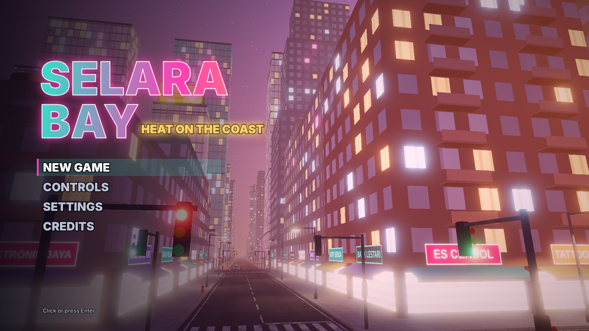
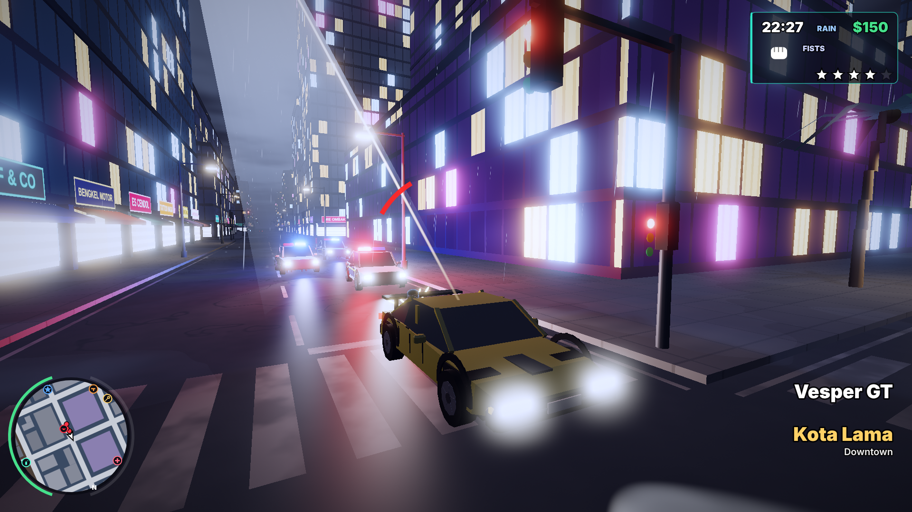
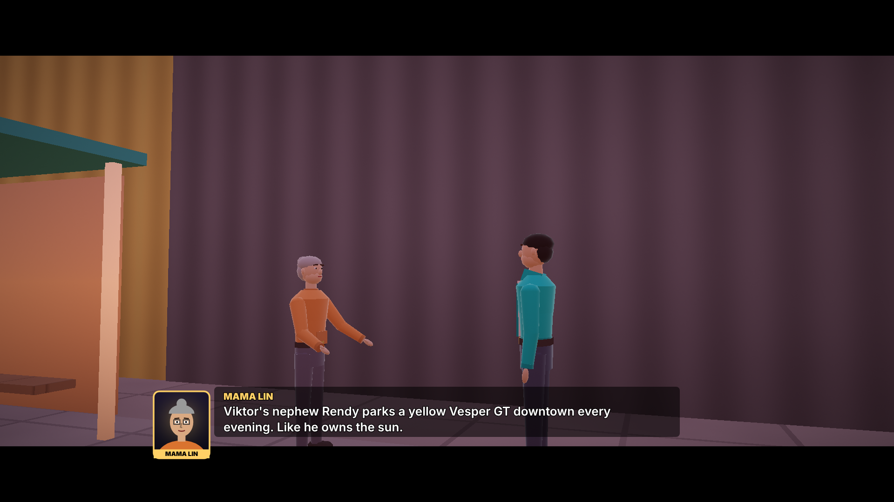
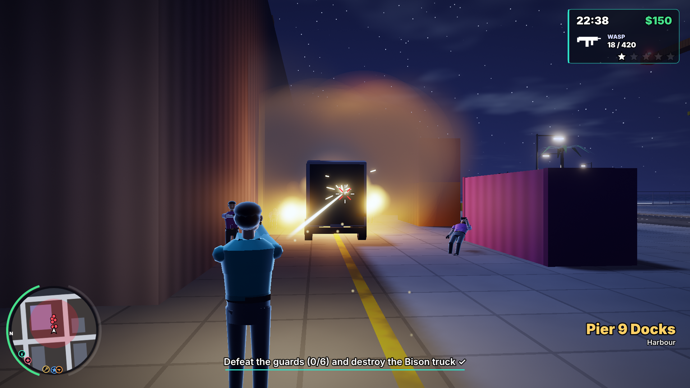

# SELARA BAY — Heat on the Coast

[](https://make.fun/bounty/gta6-01)
[](https://make.fun/bounty/gta6-01)
[](https://make.fun/bounty/gta6-01)

> _Practice build. The make.fun kit was not available, so the three badges above are placeholders in the kit's
> usual format and `main.ts` / `vendor/` are intentionally absent._

An original 3D open-world crime game set in **Selara Bay**, a tropical coastal city. Kai Santoso comes home after five
years to find the Black Orchid syndicate squeezing the coast. Steal cars, outrun the police, fight the Orchid and
take the bay back — in a fully procedural city rendered by a hand-written WebGL2 engine, with a soundtrack composed
in code and synthesized live.

Everything — geometry, characters, cars, textures, signage, sound effects and music — is generated at runtime.
There are no external assets, libraries, fonts or CDNs.

## Screenshots

| | |
|---|---|
|  |  |
|  |  |

## Features

- **A 10×10-block city** (~1 km²) in six districts: glass towers of Kota Lama, terracotta Kemuning, the gardens and
  pools of Bukit Asri, the cranes and containers of Pier 9 Docks, the Pantai Selara beachfront, and parks.
  Landmarks include Orchid Tower with its glowing neon emblem, Lin's Garage, Bank Samudra, the hospital, Police HQ,
  Kilat Respray and Bang Bang Arms.
- **Left-hand traffic** on a road graph with working traffic lights, turning AI, honking, back-outs and a deadlock
  breaker; pedestrians who cross at zebras on green, chat, use phones, flee gunfire and dive from speeding cars.
- **Seven drivable vehicles** (Kancil, Merpati, Selara Taxi, Vesper GT, Bajak, Bison, Garuda Patrol) with arcade
  physics, handbrake drifts, skid marks, visible damage, fire and explosions; the **Rajawali** police helicopter
  with a volumetric spotlight that can be shot down.
- **Wanted system** (0–5 stars) with line-of-sight tracking, flashing stars and a search area, chase cars routing
  over the road graph, officers on foot who arrest or shoot, and roadblocks at 3+ stars.
- **Combat**: fists, Kobra 9 pistol, Wasp SMG and Thunder shotgun — hitscan with tracers, muzzle light, sparks,
  decals, casings, recoil, crosshair bloom, hit markers and damage indicators. Gang AI uses cover and strafes.
- **Six story missions** with in-engine cutscenes (cinematic cameras, letterbox, subtitles and portrait cards):
  _Homecoming, Yellow Fever, Collections, Wheelman, Low Tide, Orchid Falls_ — then end credits and free roam.
- **Side content**: 12 hidden Orchid tags, the respray shop, the gun shop and a stats screen.
- **Day/night cycle** (1 s = 1 game minute), weather with rain and wet roads, save/load, settings.
- **Soundtrack composed in code**: three radio stations (synthwave, lo-fi, gamelan fusion) with 10 songs that keep
  playing "live" while you switch, a title theme, character themes, dynamic chase layers, stingers and a credits
  reprise. See [MUSIC.md](MUSIC.md).

## Controls

| Key | Action |
|---|---|
| W A S D | Move / drive |
| Mouse | Look (click the game to capture the mouse) |
| Shift | Sprint (stamina) |
| Space | Jump / handbrake |
| Right mouse | Aim |
| Left mouse | Shoot, punch, drive-by |
| Q / E / wheel | Switch weapon |
| R | Reload on foot / next radio station in a car |
| F | Enter / exit / steal vehicle |
| H | Horn |
| M | Big map (click to set a waypoint) |
| C | Cinematic camera |
| Esc | Pause |
| F3 | FPS counter |

## How to run

The game is a static site in `game/` — no build step.

```bash
npx serve game
```

Then open the printed URL in desktop Chrome. Any static file server works (`python3 -m http.server -d game`).
It is also deployable as-is on Vercel (`vercel.json` serves `game/`).

Automated play-through and screenshots (Playwright + headless Chromium):

```bash
npm install
node tools/playtest.mjs
node tools/screenshots.mjs
```

## Engine

Selara Bay runs on a small custom WebGL2 renderer written for this game (`game/js/engine/`), no third-party code:

- **Frame graph**: directional shadow pass (2048² map, camera-fitted and texel-snapped, 3×3 PCF) → sky dome →
  opaque chunks and instanced batches → animated water → additive light cones and particles → post-processing.
- **One lit shader** with sun/moon + hemisphere ambient, up to 48 point/spot lights (streetlights, headlights,
  lightbars, neon, muzzle flashes, the helicopter spotlight) with per-light clamping, rim lighting, exponential
  height fog and wet-road puddles. Materials are procedural: window grids that glow at night and reflect the sky
  by day, asphalt grime and cracks, paving slabs, corrugated metal, roof tiles, car clearcoat and glass.
- **Geometry** is generated by a mesh builder (beveled boxes, tapered cylinders, ellipsoids, lofted car bodies),
  merged into 2×2-block chunk meshes with frustum culling, and **instancing** for trees, lamps, traffic lights,
  cars, wheels, characters (one instance per body part), pickups and markers.
- **Post**: HDR target, bloom down/up-sample chain, eye adaptation, ACES tone mapping, per-time-of-day color
  grading, vignette, desaturation (death/arrest) and a pause blur. Quality presets and adaptive resolution scaling.

Gameplay simulates on the ground plane (2D collision grid with circle/box resolution and 3D raycasts) and renders
in full 3D.

## Project layout

```
game/index.html, style.css
game/js/main.js            boot, loop, state machine
game/js/core/              input, math, events, camera rig
game/js/engine/            WebGL2 renderer, shaders, mesh builder, instancing, shadows, sky, post, frustum
game/js/world/             city generation, chunk meshes, roads, collision, props, signs, water, GPS
game/js/entities/          player, characters, vehicles, pedestrians and their procedural models
game/js/ai/                traffic, police/wanted, gang combat AI, helicopter
game/js/combat/            weapons, combat resolution, pickups
game/js/fx/                particles/decals, transient lights
game/js/story/             missions, dialogue/cutscenes, story actors, markers
game/js/ui/                HUD, minimap, big map, menus, portraits, theme
game/js/audio/             SFX engine, radio, music synth/fx/sequencer and songs
tools/                     playtest.mjs, screenshots.mjs, static server
```

## License

MIT © I Wayan Bagus Somabawa — see [LICENSE](LICENSE).
